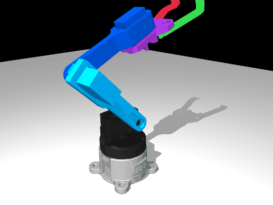
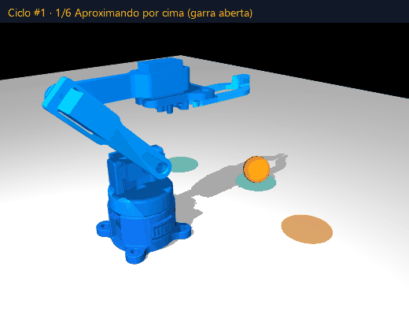
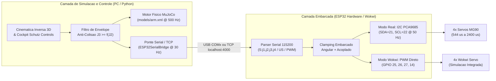
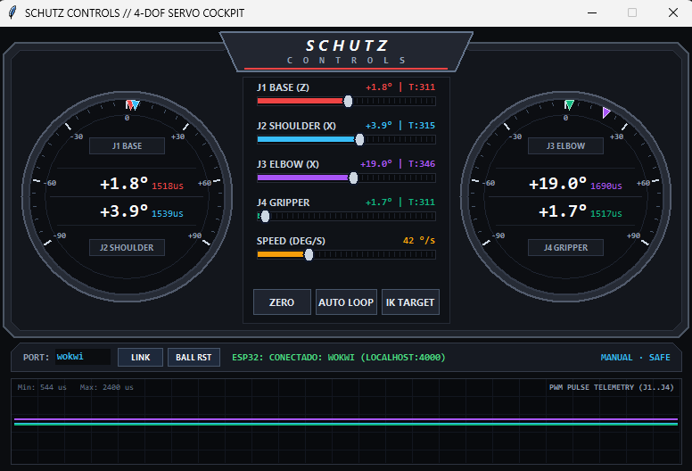
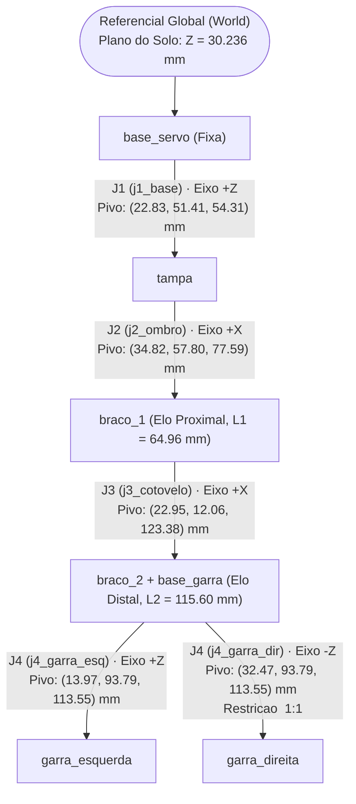
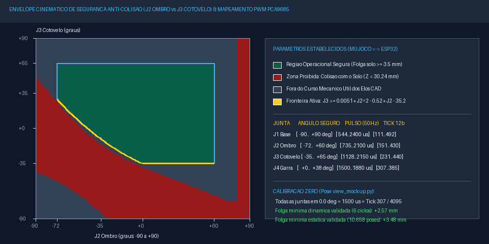
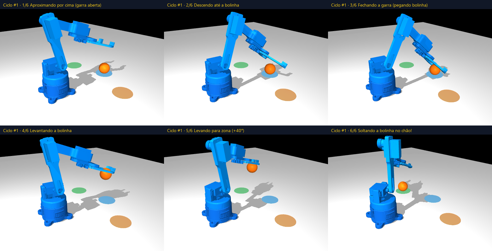
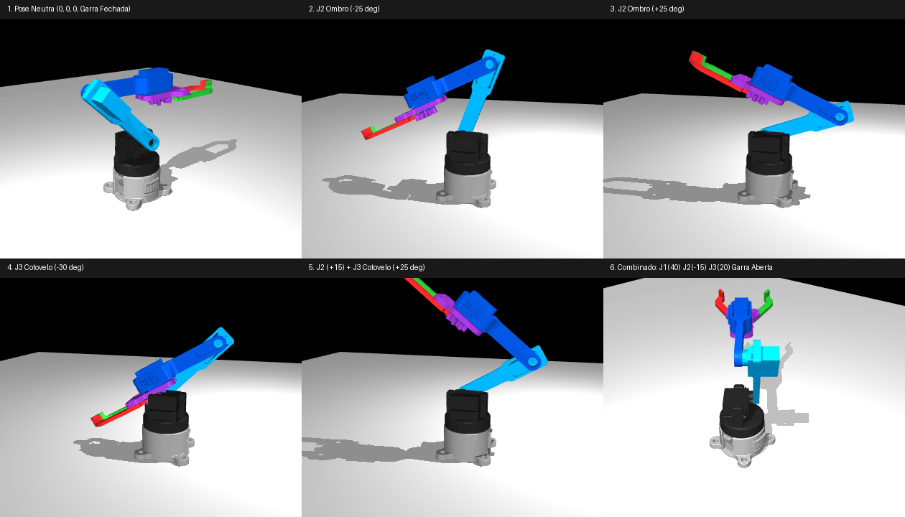

<div align="center">

# ROBOT_ARM — Gemeo Digital de Manipulador Robotico 4-DOF

**Simulacao Fisica Multicorpo (MuJoCo) · Controle Embarcado (ESP32 + PCA9685) · Hardware-in-the-Loop (Wokwi RFC2217)**

<br>


<br>

<table>
  <tr>
    <td align="center" width="50%">
      
      <br>
      <sub><b>Figura 1.</b> Varredura cinemática contínua das 4 juntas (<code>models/arm.xml</code>)</sub>
    </td>
    <td align="center" width="50%">
      
      <br>
      <sub><b>Figura 2.</b> Ciclo autônomo Pick-and-Drop com Cinemática Inversa 3D e restrição anti-colisão</sub>
    </td>
  </tr>
</table>

</div>

---

## Sumario Executivo

Este repositorio implementa o **Gemeo Digital (Digital Twin)** completo de um manipulador robotico serial de **4 graus de liberdade (4-DOF)** acionado por micro servomotores **MG90** (`-90°` a `+90°`), com estrutura mecânica modelada em SolidWorks (personalizacao industrial **WEG by Schutz**) e impressa em 3D.

A arquitetura integra três camadas sincronizadas em tempo real:
1. **Simulacao Fisica e Cinematica ([MuJoCo 3.x](https://mujoco.org))**: Modelo MJCF ([`models/arm.xml`](models/arm.xml)) calibrado diretamente a partir dos eixos cilindricos reais das malhas CAD exportadas, com cinemática inversa analítica 3D, restrição de engrenagem simétrica na garra (`<equality>`) e envelope de segurança acoplado contra colisão com o solo.
2. **Firmware Embarcado de Producao ([`firmware/`](firmware))**: Código C++ (PlatformIO / Arduino ESP32) para acionamento real via driver **PCA9685 (I2C 12-bit PWM @ 50 Hz)** nos pinos `SDA = GPIO 21` e `SCL = GPIO 22`.
3. **Ambiente Isolado Hardware-in-the-Loop ([`wokwi_sim/`](wokwi_sim))**: Projeto independente para simulação eletrônica no VS Code (Wokwi) com acionamento PWM direto nos pinos `GPIO 25, 26, 27, 14` e ponte TCP bidirecional em tempo real (`localhost:4000`) com o MuJoCo.

> [!IMPORTANT]
> **Garantia de Seguranca Fisica e Anti-Colisao:** Tanto o simulador em Python ([`sim/simulador.py`](sim/simulador.py)) quanto os firmwares em C++ ([`firmware/src/main.cpp`](firmware/src/main.cpp) e [`wokwi_sim/src/main.cpp`](wokwi_sim/src/main.cpp)) aplicam em tempo real os limites operacionais de cada junta e a lei de restrição cinemática acoplada entre ombro e cotovelo ($J_3 \ge J_{3,\min}(J_2)$), impedindo que a garra ou os elos colidam com o solo ou com a própria base, mesmo diante de comandos manuais ou seriais fora de faixa.

---

## Arquitetura do Sistema e Fluxo de Sinais



### Interface de Comando e Telemetria (`SCHUTZ CONTROLS`)

O painel de controle ([`create_tk_panel`](sim/simulador.py#L526-L830)) foi projetado em `tk.Canvas` vetorial no estilo de instrumentação de hardware (*cockpit*), reunindo em uma única janela:
- **Mostradores Radiais Duplos (`J1/J2` à esquerda e `J3/J4` à direita)**: Exibem em tempo real o ângulo físico da junta (em graus) e a largura de pulso PWM correspondente (em microssegundos, `544..2400 µs`), com ponteiros móveis na escala angular de `-90°` a `+90°`.
- **Coluna Central de Sliders Segmentados**: Controle individual de `J1 BASE`, `J2 SHOULDER`, `J3 ELBOW`, `J4 GRIPPER` (com indicação simultânea do registrador `Tick` de 12 bits do PCA9685, ex: `T:307`) e ajuste dinâmico do limitador de velocidade angular (`SPEED`, em `°/s`), além dos acionadores diretos `ZERO`, `AUTO LOOP` e `IK TARGET`.
- **Osciloscopio Inferior de Pulsos PWM**: Gráfico temporal contínuo das 4 larguras de pulso enviadas ao controlador embarcado, acompanhado da barra de vínculo Serial/TCP (`PORT: wokwi` ou `COMx`).

<div align="center">



<sub><b>Figura 3.</b> Cockpit de controle e telemetria <code>SCHUTZ CONTROLS</code> conectado em tempo real ao simulador Wokwi via <code>localhost:4000</code> e ao motor físico MuJoCo.</sub>

</div>

---

## Modelagem Cinematica e Calibracao de Montagem (Pose Zero)

As malhas STL em [`meshes/`](meshes) preservam a origem global da montagem do SolidWorks (`mm` convertidos para `m` via `scale="0.001 0.001 0.001"`). O centro de rotação de cada junta revoluta (`<joint type="hinge">`) foi extraído analiticamente da geometria cilíndrica dos alojamentos dos servos.



### Referencia de Calibracao Fisica (`0.0°` = Pose `view_mockup.py`)

Para garantir correspondência exata entre o robô físico e o modelo virtual, a montagem mecânica dos chifres (*horns*) dos servos MG90 é realizada com todos os canais energizados em **`0.0°` (`1500 µs` / `Tick 307` em 12 bits a `50 Hz`)**, reproduzindo a geometria de [`sim/view_mockup.py`](sim/view_mockup.py):

| Canal PCA9685 | Pino Wokwi | Junta no Modelo | Eixo | Pose Fisica de Montagem em `0.0°` (`1500 µs` / `Tick 307`) |
|:---:|:---:|---|:---:|---|
| **CH0** | `GPIO 25` (`D25`) | `j1_base` | $+Z$ | Tampa superior alinhada frontalmente com a base fixa (`+Y`) |
| **CH1** | `GPIO 26` (`D26`) | `j2_ombro` | $+X$ | Elo 1 (`braco_1`) na inclinação neutra de referência do CAD |
| **CH2** | `GPIO 27` (`D27`) | `j3_cotovelo` | $+X$ | Elo 2 (`braco_2` + `base_garra`) nivelado horizontalmente para frente |
| **CH3** | `GPIO 14` (`D14`) | `j4_garra_esq` / `dir` | $\pm Z$ | Dedos da garra fechados e alinhados no plano central |

---

## Envelope de Seguranca Anti-Colisao e Limites de Sinais (MuJoCo e ESP32)

Embora um servomotor MG90 isolado aceite comandos entre `-90.0°` (`544 µs`) e `+90.0°` (`2400 µs`), a montagem mecânica em cadeia serial impõe duas classes de restrições físicas:
1. **Limites Individuais por Junta**: Evitam interferência mecânica entre elos adjacentes, batente de fim de curso dos dedos da garra e colisão do Elo 1 com o solo em inclinações reversas extremas.
2. **Restricao Cinematica Acoplada Solo-Ombro-Cotovelo ($J_2 \times J_3$)**: Quando o ombro $J_2$ inclina o braço para baixo ($J_2 < 0^\circ$), manter o cotovelo $J_3$ em ângulos baixos ou negativos faria a ponta da garra penetrar até `36.2 mm` abaixo do nível do solo ($Z_{\text{solo}} = 30.236\text{ mm}$).

<div align="center">



<sub><b>Figura 4.</b> Mapeamento exaustivo do espaço de juntas $(J_2, J_3)$ (10.658 poses avaliadas nas malhas STL e cápsulas de contato), destacando a zona de colisão com o solo (vermelho), a fronteira polinomial ativa (amarelo) e a região operacional permitida (verde).</sub>

</div>

### 1. Tabela de Limites Operacionais Estabelecidos (Graus, Microssegundos e Ticks 12-Bit)

A conversão entre ângulo da junta $\theta_j \in [-90^\circ, +90^\circ]$, largura de pulso $T_{\text{on}}$ ($\mu\text{s}$) e registrador `OFF_TICK` de 12 bits (`0..4095`) do PCA9685 operando a $f_{\text{PWM}} = 50\text{ Hz}$ ($T = 20\,000\,\mu\text{s}$) utiliza interpolação linear assimétrica centrada em `1500 µs`:

$$T_{\text{on}}(\theta_j) = \begin{cases} 1500 + \dfrac{\theta_j}{90^\circ}\,(2400 - 1500), & \theta_j \ge 0^\circ \\[8pt] 1500 + \dfrac{\theta_j}{90^\circ}\,(1500 - 544), & \theta_j < 0^\circ \end{cases} \qquad \text{Tick}_{12\text{b}} = \operatorname{round}\!\left(\frac{T_{\text{on}}(\theta_j)}{20\,000}\times 4096\right)$$

| Junta | Atuador MJCF | Limite Angular Minimo | Centro (Pose Zero) | Limite Angular Maximo | Faixa de Pulso Seguro (`50 Hz`) | Faixa de Ticks PCA9685 (`12-bit`) | Restricao Fisica determinante |
|---|---|:---:|:---:|:---:|:---:|:---:|---|
| **J1 Base** | `servo_j1_base` | `-90.0°` | `0.0°` | `+90.0°` | `544 µs .. 2400 µs` | `111 .. 492` | Curso nominal do servo MG90 em giro livre $Z$ |
| **J2 Ombro** | `servo_j2_ombro` | `-72.0°` | `0.0°` | `+60.0°` | `735 µs .. 2100 µs` | `151 .. 430` | Curso frontal até coleta no solo (`-72°`) e limite traseiro do Elo 1 (`+60°`) |
| **J3 Cotovelo** | `servo_j3_cotovelo` | `-35.0°` | `0.0°` | `+65.0°` | `1128 µs .. 2150 µs` | `231 .. 440` | Limite inferior na pose neutra (`-35°`) e recolhimento superior (`+65°`) |
| **J4 Garra** | `servo_j4_garra` | `0.0°` | `0.0°` | `+38.0°` | `1500 µs .. 1880 µs` | `307 .. 385` | Fechamento completo sem sobre-torque nas engrenagens (`0°`) até abertura total (`+38°`) |

### 2. Lei de Restricao Cinematica Acoplada ($J_3 \ge J_{3,\min}(J_2)$)

Para qualquer ângulo comandado no ombro $J_2 \in [-72.0^\circ, +60.0^\circ]$, o ângulo mínimo permitido para o cotovelo $J_3$ é governado pela curva quadrática de proteção de solo:

$$J_{3,\min}(J_2) = \operatorname{clip}\!\left(0.0051\,J_2^2 - 0.520\,J_2 - 35.2,\; -35.0^\circ,\; +65.0^\circ\right)$$

- **Comportamento Automatico no Simulador e no ESP32**: Se o operador (via slider manual, teclado ou comando serial `S:`, `US:`, `PWM:`) abaixar o ombro $J_2$ para `-70.0°` enquanto $J_3$ estiver em `0.0°`, o filtro de segurança eleva automaticamente $J_3$ para `+26.2°` (`1791 µs` / `Tick 367`), fazendo a garra deslizar paralelamente ao solo com folga vertical positiva.
- **Validacao Experimental**:
  - **Varredura Estatica (10.658 poses)**: Folga vertical mínima entre qualquer vértice STL / cápsula de colisão e o plano do solo ($Z = 30.236\text{ mm}$) igual a **`+3.48 mm`**.
  - **Simulacao Dinamica Continua (6 ciclos completos Pick-and-Drop / 17.000 passos de integracao)**: Folga vertical mínima dinâmica sob ação da gravidade igual a **`+2.57 mm`** (`0` colisões com o solo).

---

## Ciclo Autonomo Pick-and-Drop e Cinematica Inversa 3D

O controlador autônomo [`PickAndDropLoopController`](sim/simulador.py#L323-L431) executa uma máquina de estados finitos de 7 estágios que localiza a esfera dinâmica (`bolinha`, raio `10.5 mm`, massa `4 g`) em tempo real via `data.xpos`, soluciona a Cinemática Inversa 3D analítica ([`solve_ik_3d`](sim/simulador.py#L105-L148)) e alterna ciclicamente os pontos de deposição entre três zonas no solo (`+40°`, `-40°` e `0°`).

<div align="center">



<sub><b>Figura 5.</b> Decomposição dos 6 estágios principais do ciclo autônomo: (1) aproximação superior com garra aberta, (2) descida controlada até o ponto de coleta, (3) fechamento físico da garra sobre a esfera, (4) elevação vertical segura, (5) transporte angular até a zona de descarga e (6) abertura da garra com queda livre no solo.</sub>

</div>

<details>
<summary><b>Formulacao Matematica da Cinematica Inversa 3D Analitica (Clique para expandir)</b></summary>
<br>

Dado o ponto alvo $\mathbf{p} = (x, y, z)^\top$ para o centro da garra (`site="grip_center"`) e as coordenadas dos pivôs no referencial neutro $\mathbf{p}_{J1}, \mathbf{p}_{J2}, \mathbf{p}_{J3}, \mathbf{p}_{\text{grip0}}$:

1. **Desacoplamento da Base ($J_1$) com compensacao de excentricidade lateral $\Delta x_0 = x_{\text{grip0}} - x_{J1}$**:
   $$r_{xy} = \sqrt{(x - x_{J1})^2 + (y - y_{J1})^2}, \qquad y_{\text{local}} = \sqrt{r_{xy}^2 - \Delta x_0^2}$$
   $$J_1 = \operatorname{atan2}(-(x - x_{J1}),\, y - y_{J1}) + \operatorname{atan2}(\Delta x_0,\, y_{\text{local}})$$

2. **Solucao Planar 2R no Plano Sagital Equivalente ($J_2, J_3$)**:
   Com $L_1 = \|\mathbf{p}_{J3,yz} - \mathbf{p}_{J2,yz}\|$, $L_2 = \|\mathbf{p}_{\text{grip0},yz} - \mathbf{p}_{J3,yz}\|$, $\Delta y = y_{J1} + y_{\text{local}} - y_{J2}$ e $\Delta z = \max(z, Z_{\text{solo}} + 13.5\text{ mm}) - z_{J2}$:
   $$\cos\alpha = \frac{\Delta y^2 + \Delta z^2 - L_1^2 - L_2^2}{2\,L_1\,L_2}, \qquad \alpha = \pm\arccos(\cos\alpha)$$
   $$J_3 = \alpha - (\phi_2 - \phi_1), \qquad J_2 = \operatorname{atan2}(\Delta z, \Delta y) - \phi_1 - \operatorname{atan2}(L_2\sin\alpha,\, L_1 + L_2\cos\alpha)$$
   A solução selecionada minimiza o deslocamento do ombro dentro do envelope seguro e aplica `clamp_safe_workspace(J1, J2, J3, J4)`.

</details>

<div align="center">



<sub><b>Figura 6.</b> Painel de verificação cinemática renderizado offscreen por <code>sim/experiments/testar_robo_completo.py</code> ilustrando a pose neutra de calibração (<code>0°, 0°, 0°, 0°</code>) e excursões independentes e combinadas das juntas.</sub>

</div>

---

## Guia de Execucao Rapida

### 1. Instalacao das Dependencias (Python 3.9+ / Windows)

O repositório inclui em [`sim/x64/`](sim/x64) os binários de renderização OpenGL por software (Mesa Gallium Lavapipe), permitindo executar o MuJoCo tanto em estações com GPU dedicada quanto em ambientes sem acelerador gráfico.

```powershell
git clone https://github.com/ryhanschutz/robot_arm.git
cd robot_arm
pip install -r requirements.txt
```

### 2. Modos de Operacao do Simulador MuJoCo

| Comando | Descricao Tecnica |
|---|---|
| `python sim/simulador.py` | Inicia o simulador completo com painel gráfico **Tkinter (MG90 / PCA9685)**, limitador de velocidade angular (*slew-rate* ajustável, padrão `42 °/s`), proteção anti-colisão ativa e conexão automática ao Wokwi (`localhost:4000`) |
| `python sim/simulador.py --desafio` | Inicia diretamente executando o ciclo contínuo **Pick-and-Drop** da esfera com telemetria em tempo real |
| `python sim/desafio_bolinha.py` | Atalho dedicado para inicialização direta no modo Desafio Pick-and-Drop |
| `python sim/simulador.py --port COM3` | Conecta o Gêmeo Digital diretamente a um **ESP32 físico** na porta serial USB especificada (`115200 baud`) |
| `python sim/view_mockup.py models/arm.xml` | Abre o visualizador nativo do MuJoCo na Pose Zero de calibração mecânica (`0.0°` em todas as juntas) |

<details>
<summary><b>Atalhos de Teclado na Janela 3D do MuJoCo (Clique para expandir)</b></summary>
<br>

| Tecla | Acao no Simulador |
|:---:|---|
| `Z` ou `0` | Calibra imediatamente todas as 4 juntas em `0.0°` (`1500 µs` / `Tick 307`) e envia `ZERO` ao ESP32 |
| `L` | Alterna em tempo real entre **Modo Manual** e **Modo Desafio (Loop Pick-and-Drop)** |
| `R` | Reposiciona a esfera na zona central de coleta com velocidade nula |
| `G` | Calcula a Cinemática Inversa 3D para a posição atual da esfera e move o braço até ela |
| `1` / `2` | Decrementa / incrementa **J1 Base** em passos de `2.5°` |
| `3` / `4` | Decrementa / incrementa **J2 Ombro** em passos de `2.5°` (com compensação anti-solo automática em J3) |
| `5` / `6` | Decrementa / incrementa **J3 Cotovelo** em passos de `2.5°` (respeitando $J_3 \ge J_{3,\min}(J_2)$) |
| `7` / `8` | Fecha / abre **J4 Garra** em passos de `2.0°` dentro da faixa `[0.0°, +38.0°]` |

</details>

---

## Integracao Embarcada: Hardware Real (PCA9685) vs Simulacao Isolada (Wokwi)

O repositório mantém dois projetos PlatformIO estritamente separados para não misturar dependências de simulação com o firmware de bancada:

### 1. Firmware de Producao: ESP32 + Modulo PWM PCA9685 ([`firmware/`](firmware))

Projetado para o hardware físico utilizando barramento I2C Fast Mode (`400 kHz`) no endereço `0x40`.

| Pino ESP32 | Pino PCA9685 | Funcao Eletrica |
|:---:|:---:|---|
| `GPIO 21` | `SDA` | Linha de dados I2C |
| `GPIO 22` | `SCL` | Linha de clock I2C |
| `3V3` | `VCC` | Alimentação lógica do CI PCA9685 (`3.3 V`) |
| `Fonte Externa 5V (2A..3A)` | `V+` | Barramento de potência exclusivo dos 4 servos MG90 |
| `GND` | `GND` | Referência comum (ESP32 + PCA9685 + Fonte 5V) |

```powershell
pio run -d firmware                  # Compila o firmware de producao (ESP32 + PCA9685)
pio run -d firmware -t upload        # Grava no ESP32 fisico via USB
```

### 2. Ambiente Isolado Hardware-in-the-Loop no Wokwi ([`wokwi_sim/`](wokwi_sim))

Como o emulador Wokwi não possui o CI PCA9685 no catálogo padrão e o periférico `LEDC` do core Arduino ESP32 3.x (`ESP-IDF 5.x`) utiliza `XTAL_CLK` não propagado aos servos virtuais, o projeto [`wokwi_sim/`](wokwi_sim) aciona os 4 componentes `wokwi-servo` diretamente por trens de pulso de `50 Hz` (`544..2400 µs`) e gera automaticamente a imagem unificada `firmware_merged.bin` (`bootloader 0x1000 + partitions 0x8000 + app 0x10000`) via [`wokwi_sim/merge_firmware.py`](wokwi_sim/merge_firmware.py).

| Servo no Diagrama Wokwi | Junta Correspondente | Pino de Sinal ESP32 | Alimentacao no Diagrama |
|:---:|---|:---:|:---:|
| `servo1` | **J1 Base** | `D25` (`GPIO 25`) | `VIN (5V)` / `GND.1` |
| `servo2` | **J2 Ombro** | `D26` (`GPIO 26`) | `VIN (5V)` / `GND.1` |
| `servo3` | **J3 Cotovelo** | `D27` (`GPIO 27`) | `VIN (5V)` / `GND.1` |
| `servo4` | **J4 Garra** | `D14` (`GPIO 14`) | `VIN (5V)` / `GND.1` |

```powershell
pio run -d wokwi_sim                 # Compila e gera firmware_merged.bin automaticamente
```

Para executar a co-simulação **MuJoCo + Wokwi no VS Code**:
1. Abra [`wokwi_sim/diagram.json`](wokwi_sim/diagram.json) e inicie a simulação Wokwi (que escuta na porta TCP `4000` via `rfc2217ServerPort = 4000` definida em [`wokwi_sim/wokwi.toml`](wokwi_sim/wokwi.toml)).
2. Execute `python sim/simulador.py`. A ponte [`ESP32SerialBridge`](sim/simulador.py#L144-L293) conecta-se automaticamente a `localhost:4000` (suportando IPv6 `::1` e IPv4 `127.0.0.1`) e sincroniza os 4 servos em tempo real.

<details>
<summary><b>Especificacao do Protocolo Serial ASCII (115200 baud, compartilhado entre Firmware e Wokwi)</b></summary>
<br>

| Comando Serial | Exemplo | Resposta / Comportamento no ESP32 |
|---|---|---|
| `ZERO` ou `0` | `ZERO` | Posiciona todas as 4 juntas em `0.0°` (`1500 µs` / `Tick 307`) para calibração de montagem |
| `STATUS` ou `?` | `STATUS` | Imprime tabela formatada com ângulo (`deg`), pulso (`us`), tick (`0..4095`) e estado I2C |
| `j1,j2,j3,j4` | `0,-45,20,25` | Aplica ângulos em graus (com clamping anti-colisão) e imprime telemetria detalhada |
| `S:j1,j2,j3,j4` | `S:0.0,-70.7,26.1,1.0` | Comando de *streaming* contínuo (`30 Hz`) enviado pelo MuJoCo (silencioso para baixa latência) |
| `US:u1,u2,u3,u4` | `US:1500,1200,1750,1800` | Define larguras de pulso em microssegundos (convertidas e validadas pelo filtro cinemático) |
| `PWM:t1,t2,t3,t4` | `PWM:307,245,358,368` | Define ticks de 12 bits do PCA9685 (convertidos e validados pelo filtro cinemático) |
| `FREQ:hz` | `FREQ:50` | Ajusta a frequência do oscilador do PCA9685 (`24..200 Hz`) e recalcula os ticks ativos |
| `DIR:d1,d2,d3,d4` | `DIR:1,-1,1,1` | Inverte a polaridade lógica (`+1` ou `-1`) de qualquer servo sem alterar a fiação |
| `OFFSET:o1,o2,o3,o4` | `OFFSET:0,1.5,-1.0,0` | Aplica ajuste fino de zero mecânico (em graus) por junta |

</details>

---

## Estrutura do Repositorio

```text
robot_arm/
├── models/
│   └── arm.xml                        # Modelo MJCF principal calibrado (4-DOF, limites seguros e engrenagem da garra)
├── meshes/                            # 7 malhas STL exportadas na origem global do CAD (escala 1:1000 m)
├── sim/
│   ├── simulador.py                   # Simulador principal (MuJoCo + Tkinter + IK 3D + Anti-Colisao + Ponte ESP32/Wokwi)
│   ├── desafio_bolinha.py             # Inicializador direto do modo autonomo Pick-and-Drop
│   ├── view_mockup.py                 # Visualizador de referencia da Pose Zero de montagem (0.0 deg)
│   ├── animar_robo.py                 # Animacao cinematica senoidal das 4 juntas
│   ├── x64/                           # Binarios OpenGL por software (Mesa Gallium) para execucao sem GPU
│   └── experiments/                   # Scripts de geracao offscreen de GIFs, paineis e auditoria geometrica
├── firmware/                          # Projeto PlatformIO de producao (ESP32 + Driver I2C PCA9685)
│   ├── platformio.ini
│   └── src/main.cpp
├── wokwi_sim/                         # Projeto PlatformIO/Wokwi isolado (ESP32 PWM Direto + RFC2217 porta 4000)
│   ├── platformio.ini
│   ├── wokwi.toml
│   ├── diagram.json
│   ├── merge_firmware.py
│   └── src/main.cpp
├── prints/
│   ├── robot/                         # Malhas STL limpas (sem geometria dos servos) para impressao 3D
│   └── case/                          # Gabinete e tampa da eletronica de controle
├── cad/                               # Arquivos nativos SolidWorks (.SLDPRT / .SLDASM) — somente leitura
├── docs/
│   └── images/                        # GIFs, cockpit Schutz Controls, paineis e envelope de seguranca
├── requirements.txt
└── README.md
```

---

<div align="center">

Desenvolvido por **[@ryhanschutz](https://github.com/ryhanschutz)** · Engenharia de Controle, Modelagem Multicorpo e Sistemas Embarcados

</div>
