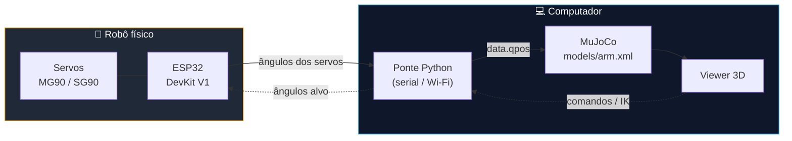
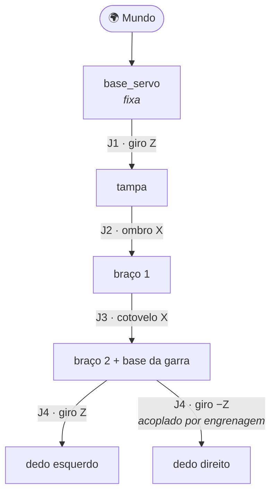

<div align="center">

# 🦾 robot_arm

### Gêmeo digital de um braço robótico 4-DOF — MuJoCo + ESP32

*O robô existe na vida real. Esta é a sua cópia virtual — e em breve ela vai se mover junto com ele.*

<br>


<br>


<sub>Simulação real renderizada a partir de <code>models/arm.xml</code> · gerada por <code>sim/experiments/render_gif.py</code></sub>

</div>

---

## ✨ Sobre o projeto

Um mini braço robótico de **4 graus de liberdade** (base, ombro, cotovelo e garra), impresso em 3D e acionado por micro servos, com carcaça personalizada **WEG by Schutz**.

O objetivo é construir um **gêmeo digital**: um modelo físico no [MuJoCo](https://mujoco.org) que espelha o robô real, alimentado pelos dados dos servos. Com ele dá para testar movimentos, validar cinemática e, no futuro, treinar controladores sem arriscar o hardware.

| | |
|---|---|
| 🧩 **Modelo fiel ao CAD** | Malhas exportadas da montagem SolidWorks (`mm → m`), com os eixos das juntas medidos nos cilindros reais |
| 🎮 **Viewer interativo** | Animação em tempo real e painel de sliders dos atuadores |
| ⚙️ **Garra acoplada** | Os dois dedos abrem e fecham juntos por restrição de engrenagem (`<equality>`) |
| 🖥️ **Funciona sem GPU** | Renderização por software (Mesa) incluída em `sim/x64/` |
| 🔌 **Pronto para dados reais** | Atuadores `servo_j1` … `servo_j4` e `qpos` já mapeados às juntas físicas |

---

## 🚧 Status

```
Simulação (cinemática + visual)   ████████████████████  pronta
Calibração das juntas             ████████████████░░░░  medida no CAD
Firmware ESP32                    ███░░░░░░░░░░░░░░░░░  projeto criado (template)
Ponte robô real → simulação       ░░░░░░░░░░░░░░░░░░░░  planejada
```

- [x] Modelo MJCF com 4 juntas, atuadores e engrenagem da garra
- [x] Viewer animado e render offscreen de poses
- [x] Eixos das juntas medidos a partir da montagem do SolidWorks
- [ ] Firmware ESP32 controlando os servos (PWM)
- [ ] Telemetria dos ângulos reais (serial / Wi-Fi)
- [ ] Ponte Python que escreve os ângulos reais em `data.qpos`
- [ ] Calibração fina de limites, torque e inércia com o robô físico
- [ ] Controle por cinemática inversa (alvo no espaço → ângulos dos servos)

---

## 🔄 Como o gêmeo digital vai funcionar



> Linhas contínuas: **robô → simulação** (espelhamento). Linhas tracejadas: **simulação → robô** (controle), etapa futura.

---

## 🦴 Cinemática



| Junta | Nome no XML | Eixo | Limites | Atuador |
|:--:|---|:--:|:--:|---|
| **J1** | `j1_base` | Z | −90° … +90° | `servo_j1_base` |
| **J2** | `j2_ombro` | X | −60° … +60° | `servo_j2_ombro` |
| **J3** | `j3_cotovelo` | X | −60° … +60° | `servo_j3_cotovelo` |
| **J4** | `j4_garra_esq` / `j4_garra_dir` | ±Z | −2° … +35° | `servo_j4_garra` |

---

## 🚀 Começando

**Requisitos:** Python 3.9+ e Windows (as DLLs de render por software são para Windows; em outros sistemas o MuJoCo usa o OpenGL nativo).

```powershell
git clone https://github.com/ryhanschutz/robot_arm.git
cd robot_arm
pip install -r requirements.txt
```

### ▶️ Rodar a simulação

```powershell
python sim/animar_robo.py                    # animação de todas as juntas em tempo real
python sim/view_mockup.py                    # montagem estática (conferir as peças)
python sim/view_mockup.py models/arm.xml     # modelo principal + sliders dos atuadores
```

> 💡 No viewer, abra a aba **Control** (painel direito) para mover cada servo com os sliders.

### 🖼️ Gerar imagens e GIF

```powershell
python sim/experiments/testar_robo_completo.py   # painel com 6 poses
python sim/experiments/render_gif.py             # docs/images/simulacao.gif
```

---

## 📸 Galeria

<div align="center">


<sub><b>Painel de poses</b> — neutra · ombro −25° / +25° · cotovelo −30° · ombro+cotovelo · combinado com garra aberta</sub>

</div>

<details>
<summary><b>🔍 Referências de montagem (CAD)</b></summary>
<br>

Imagens de apoio usadas para conferir a montagem estão em [`docs/imagens_ref/`](docs/imagens_ref).

</details>

---

## 📁 Estrutura do repositório

```
robot_arm/
├── models/
│   ├── arm.xml                 ⭐ modelo principal (MJCF)
│   └── experiments/            testes: montagem estática, calibração da J1
├── meshes/                     os 7 STLs usados pelo arm.xml
├── sim/
│   ├── animar_robo.py          viewer animado
│   ├── view_mockup.py          viewer simples / sliders
│   ├── x64/                    OpenGL por software (Mesa)
│   └── experiments/            render de poses, GIF, inspeção de STL
├── prints/
│   ├── robot/                  STLs sem servo, para impressão 3D
│   └── case/                   caixa e tampa da eletrônica
├── cad/                        modelos sólidos SolidWorks (somente leitura)
├── firmware/                   projeto PlatformIO do ESP32
├── docs/                       auditoria, mapeamento de peças e imagens
├── requirements.txt
└── README.md
```

<details>
<summary><b>❓ Por que <code>models/arm.xml</code> é o modelo principal?</b></summary>
<br>

É o modelo carregado por `animar_robo.py` e o único com **juntas calibradas, atuadores e a restrição de engrenagem da garra**. As malhas ficam todas na origem global do CAD e o pivô de cada junta é definido apenas pelo `pos` do `<joint>`, o que evita deslocamentos acumulados entre as peças.

Uma versão anterior (garra rígida e juntas estimadas) foi descartada.

</details>

---

## 🔧 Hardware

| Componente | Detalhe |
|---|---|
| Microcontrolador | ESP32 DOIT DevKit V1 (PlatformIO, framework Arduino) |
| Atuadores | Micro servos MG90 / SG90 |
| Estrutura | Peças impressas em 3D, em [`prints/robot/`](prints/robot) |
| Gabinete | Caixa e tampa da eletrônica em [`prints/case/`](prints/case) |
| Personalização | Logo **WEG by Schutz** na base e no braço |

O projeto mecânico parte de um design de mini braço 4-DOF para micro servos MG90 / SG90, adaptado com a personalização WEG e re-medido na montagem do SolidWorks (`cad/`). O mapeamento das peças está em [`docs/README_MODELOS.md`](docs/README_MODELOS.md).

---

## 🗺️ Próximos passos

1. Implementar o firmware que lê/escreve os ângulos dos 4 servos
2. Definir o protocolo de telemetria (serial ou Wi-Fi) entre ESP32 e PC
3. Criar a ponte Python que atualiza `data.qpos` em tempo real
4. Ajustar limites, atrito e torque dos atuadores com medições do robô físico
5. Adicionar cinemática inversa e controle por alvo (posição da ponta da garra → ângulos dos servos)

---

<div align="center">

Feito por **[@ryhanschutz](https://github.com/ryhanschutz)** · Robótica, CAD e simulação 🦾

</div>
