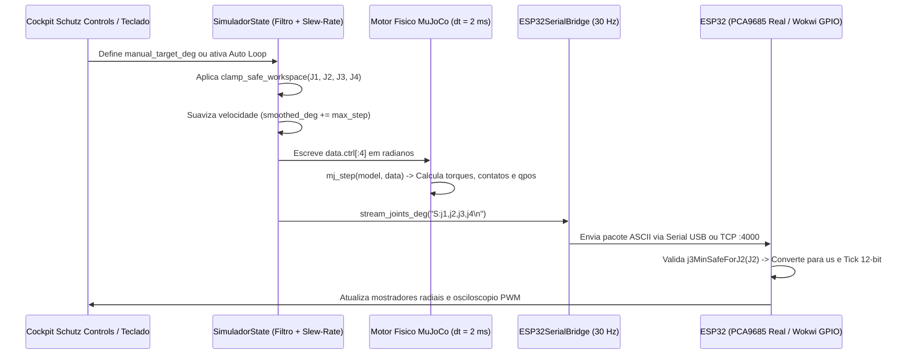

# Guia Tecnico de Arquitetura, Controle e Engenharia do Gemeo Digital (4-DOF)

Este documento descreve de forma didática e completa o funcionamento interno do projeto **`robot_arm`**, abrangendo a física multicorpo no **MuJoCo**, a matemática da **Cinemática Inversa 3D**, o algoritmo de **proteção anti-colisão**, a conversão de sinais para o módulo **PCA9685 / ESP32**, e o registro detalhado de todos os **problemas de engenharia enfrentados e como foram solucionados**.

---

## 1. Visao Geral da Arquitetura em Tempo Real

O sistema opera como um **Gêmeo Digital (Digital Twin)** fechado em três domínios sincronizados:
1. **Domínio Físico-Matemático (MuJoCo @ 500 Hz)**: Calcula a dinâmica de corpos rígidos, gravidade, inércia, restrições de engrenagem e forças de contato elípticas a cada `dt = 0.002 s` (`2 ms`).
2. **Domínio de Controle e Instrumentação (`SimuladorState` + `SCHUTZ CONTROLS` @ ~60 Hz)**: Processa entradas do usuário ou da máquina de estados autônoma, aplica limitação de velocidade (*slew-rate*), filtra comandos pelo envelope anti-colisão e renderiza os mostradores vetoriais.
3. **Domínio Embarcado (`ESP32SerialBridge` @ 30 Hz -> ESP32 @ 50 Hz PWM)**: Transmite os ângulos validados via USB Serial (`COMx`) ou Socket TCP (`localhost:4000` no Wokwi), onde o ESP32 converte graus em microssegundos (`544..2400 µs`) e ticks de 12 bits (`0..4095`) do controlador I2C PCA9685.



---

## 2. Como o Robo e Modelado e Controlado no MuJoCo (`models/arm.xml`)

### 2.1. Hierarquia Cinematica com Malhas na Origem Global

Um erro comum ao exportar montagens do SolidWorks para simuladores robóticos é exportar cada peça em um sistema de coordenadas local arbitrário, exigindo dezenas de rotações e translações manuais no XML.

Neste projeto, adotamos a **Abordagem de Referencial Global Único**:
- Todas as 7 malhas STL em [`meshes/`](../meshes) foram exportadas preservando exatamente a posição e orientação em que se encontram na montagem original do SolidWorks (com `0.0°` em todas as juntas).
- Por isso, todos os corpos (`<body>`) no [`models/arm.xml`](../models/arm.xml) possuem `pos="0 0 0"`.
- O que define onde cada peça gira é exclusivamente o atributo `pos="x y z"` e `axis="ax ay az"` dentro da tag `<joint>`:
  - **`j1_base`**: `pos="0.022828 0.051405 0.054312"` · `axis="0 0 1"` (Giro horizontal da tampa em $+Z$)
  - **`j2_ombro`**: `pos="0.034824 0.057804 0.077586"` · `axis="1 0 0"` (Inclinação do Elo 1 em $+X$)
  - **`j3_cotovelo`**: `pos="0.022953 0.012061 0.123375"` · `axis="1 0 0"` (Inclinação do Elo 2 em $+X$)
  - **`j4_garra_esq`**: `pos="0.013974 0.093787 0.113545"` · `axis="0 0 1"` (Abertura do dedo esquerdo em $+Z$)
  - **`j4_garra_dir`**: `pos="0.032474 0.093787 0.113545"` · `axis="0 0 -1"` (Abertura do dedo direito em $-Z$)

### 2.2. Como o MuJoCo Simula o Servomotor MG90 (`<actuator>`)

Um servo MG90 real possui uma malha interna de controle proporcional-derivativo (PD) que compara o ângulo do potenciômetro interno com o pulso PWM recebido e aplica tensão ao motor DC. No MuJoCo, modelamos esse comportamento com atuadores `<position>`:

$$\tau_i = \operatorname{clip}\!\Big(k_p\,(u_i - q_i) - k_v\,\dot{q}_i,\; -\tau_{\max},\; +\tau_{\max}\Big)$$

Onde:
- $u_i$ (`data.ctrl[i]`): Ângulo alvo comandado (em **radianos**).
- $q_i$ (`data.qpos[i]`): Ângulo físico real da junta no instante atual (em **radianos**).
- $k_p$ (`kp="6.5"` no ombro/cotovelo): Rigidez proporcional do servo (evita que o peso do braço faça o elo ceder sob ação da gravidade).
- $k_v$ (`kv="0.38"` no ombro/cotovelo) + `damping="0.16"` na junta: Amortecimento viscoso que elimina oscilações e vibrações ao parar.
- `forcerange="-0.65 0.65"`: Limita o torque máximo (em $\text{N}\cdot\text{m}$) ao torque físico real de um micro servo MG90 (~$1.8\text{ a }2.2\text{ kgf}\cdot\text{cm}$).

### 2.3. Acoplamento de Engrenagem da Garra (`<equality>`)

Na mecânica real do robô, um único servo (`J4`) aciona o dedo esquerdo, enquanto uma engrenagem impressa no próprio dedo transmite o movimento simétrico ao dedo direito. No [`models/arm.xml`](../models/arm.xml), isso é resolvido fisicamente pela restrição de igualdade:

```xml
<equality>
  <joint joint1="j4_garra_dir" joint2="j4_garra_esq" polycoef="0 1 0 0 0" solref="0.004 1" solimp="0.98 0.995 0.0005"/>
</equality>
```

Como `j4_garra_esq` tem eixo `0 0 1` ($+Z$) e `j4_garra_dir` tem eixo `0 0 -1` ($-Z$), impor $q_{\text{dir}} = 1 \cdot q_{\text{esq}}$ faz com que um comando positivo em `servo_j4_garra` abra ambos os dedos simetricamente, e `0.0 rad` (`0°`) feche ambos no centro.

### 2.4. Colisores Invisiveis para Preensao Fisica Realista

As malhas STL exportadas do CAD possuem milhares de triângulos não-convexos. Se ativássemos colisão direta nas malhas STL (`contype="1"`), o MuJoCo usaria o *convex hull* (envoltória convexa) de cada dedo, tapando a cavidade interna da garra e impedindo a bolinha de entrar entre os dedos!

**Solução implementada**:
1. As malhas STL têm `contype="0" conaffinity="0"` (são 100% visuais, pintadas na paleta azul industrial WEG).
2. Dentro de cada dedo (`garra_esquerda` e `garra_direita`), adicionamos 4 cápsulas cilíndricas (`class="finger_pad"`) que acompanham exatamente a curvatura interna da pinça.
3. Essas cápsulas possuem `group="4" rgba="0 0 0 0"` (totalmente invisíveis na tela), mas têm `contype="1" conaffinity="1" condim="4" friction="2.5 0.05 0.02"`, gerando atrito tangencial e torcional realista que permite segurar e erguer a bolinha pela física pura de contato.

---

## 3. Cinematica Inversa 3D e Controle Autonomo (`sim/simulador.py`)

### 3.1. Como a Cinematica Inversa (`solve_ik_3d`) Calcula os Angulos

O objetivo de [`solve_ik_3d(x, y, z)`](../sim/simulador.py#L105-L148) é responder: *"Quais ângulos $(J_1, J_2, J_3)$ posicionam o centro da garra exatamente na coordenada 3D $(x, y, z)$ da bolinha?"*

1. **Correcao de Excentricidade Lateral na Base ($J_1$)**:
   No projeto CAD, o centro da garra na pose neutra ($x_{\text{grip0}} = 23.55\text{ mm}$) possui um pequeno deslocamento lateral $\Delta x_0 = +0.72\text{ mm}$ em relação ao eixo de giro da base ($x_{J1} = 22.83\text{ mm}$). Para que a garra fique perfeitamente alinhada com o centro da bolinha em $(x, y)$:
   $$r_{xy} = \sqrt{(x - x_{J1})^2 + (y - y_{J1})^2}, \qquad y_{\text{local}} = \sqrt{r_{xy}^2 - \Delta x_0^2}$$
   $$J_1 = \operatorname{atan2}(-(x - x_{J1}),\, y - y_{J1}) + \operatorname{atan2}(\Delta x_0,\, y_{\text{local}})$$

2. **Triangulo Planar Ombro-Cotovelo ($J_2, J_3$)**:
   Uma vez alinhada a base $J_1$, o problema reduz-se a um mecanismo planar de 2 elos no plano vertical $(Y_{\text{eq}}, Z)$:
   - Elo 1 (Ombro $\to$ Cotovelo): comprimento $L_1 = 64.96\text{ mm}$, ângulo neutro $\phi_1 = 134.9^\circ$.
   - Elo 2 (Cotovelo $\to$ Centro da Garra): comprimento $L_2 = 115.60\text{ mm}$, ângulo neutro $\phi_2 = -8.17^\circ$.
   - Pela **Lei dos Cossenos**, para alcançar a distância $D = \sqrt{\Delta y^2 + \Delta z^2}$ a partir do ombro:
     $$\cos\alpha = \frac{D^2 - L_1^2 - L_2^2}{2\,L_1\,L_2}$$
   - Se $|\cos\alpha| \le 1$, existem duas configurações possíveis (*cotovelo para cima* e *cotovelo para baixo*). O algoritmo avalia ambas, descarta qualquer solução fora dos limites operacionais e aplica o filtro de segurança `clamp_safe_workspace`.

### 3.2. Maquina de Estados do Desafio da Bolinha (`PickAndDropLoopController`)

Para que o movimento autônomo não seja brusco (o que derrubaria a bolinha no momento da captura), a transição entre o ângulo inicial $\theta_{\text{ini}}$ e o ângulo final $\theta_{\text{fim}}$ de cada fase utiliza **interpolação cossenoidal de velocidade zero nas extremidades**:

$$\alpha(u) = \frac{1 - \cos(\pi u)}{2}, \quad u = \frac{t}{T_{\text{fase}}} \in [0, 1] \implies \theta(t) = \theta_{\text{ini}} + \alpha(u)\,(\theta_{\text{fim}} - \theta_{\text{ini}})$$

As 7 fases de cada ciclo são:
1. **Fase 1 (`0.90 s`)**: Posiciona a garra aberta (`J4 = 32°`) a `Z = 72 mm` exatamente acima da posição atual $(x_b, y_b)$ da bolinha.
2. **Fase 2 (`0.75 s`)**: Desce verticalmente até a altura segura de preensão (`Z = 44.2 mm`).
3. **Fase 3 (`0.65 s`)**: Fecha a garra (`J4 = 1.0°`), comprimindo os colisores `finger_pad` contra a esfera de raio `10.5 mm`.
4. **Fase 4 (`0.95 s`)**: Ergue o braço (`J2 = -15°`, `J3 = +10°`), elevando a bolinha a `~71 mm` do solo.
5. **Fase 5 (`1.05 s`)**: Gira a base `J1` para a próxima zona de descarga (`+40°`, `-40°` ou `0°`).
6. **Fase 6 (`0.50 s`)**: Abre a garra (`J4 = 32°`), liberando a bolinha sob ação da gravidade.
7. **Fase 7 (`0.65 s`)**: Recua levemente o ombro (`J2 = -30°`) enquanto a bolinha quica e estabiliza no solo para iniciar o próximo ciclo na nova posição real da bolinha.

---

## 4. Engenharia de Sinais: Conversao MuJoCo ↔ ESP32 ↔ PCA9685

### 4.1. Por que `544 us` a `2400 us` com Centro em `1500 us` (`0.0°`)?

Os micro servos MG90 operam com sinal PWM de frequência $f = 50\text{ Hz}$ (período total $T = 20\,000\,\mu\text{s}$).
- Na literatura genérica cita-se `500..2500 µs`, porém muitos lotes de MG90 atingem o batente mecânico interno da caixa de redução em `~520 µs` e `~2450 µs`, gerando corrente de *stall* (travamento) e aquecimento.
- Adotando os limites padronizados da biblioteca oficial `Servo.h` do Arduino e do simulador Wokwi (**`544 µs` para `-90°`**, **`1500 µs` para `0°`** e **`2400 µs` para `+90°`**), garantimos excursão total de `180°` sem forçar o batente físico do servo.
- No **PCA9685**, o período de `20.000 µs` é dividido em **4096 passos (12 bits, `0..4095`)**. Portanto, cada tick equivale a $4.8828\,\mu\text{s}$:
  - `-90.0°` $\to 544\,\mu\text{s} \to \text{Tick } 111$
  - `  0.0°` $\to 1500\,\mu\text{s} \to \text{Tick } 307$ (**Pose Zero de montagem = `view_mockup.py`**)
  - `+90.0°` $\to 2400\,\mu\text{s} \to \text{Tick } 492$

### 4.2. Protecao Cinematica Acoplada Anti-Colisao com o Solo

Mesmo limitando individualmente cada junta (`J1 ∈ [-90°, +90°]`, `J2 ∈ [-72°, +60°]`, `J3 ∈ [-35°, +65°]`, `J4 ∈ [0°, +38°]`), existe um acoplamento geométrico crítico entre o **ombro ($J_2$)** e o **cotovelo ($J_3$)**:
- Quando o ombro está na posição neutra ($J_2 = 0^\circ$), o cotovelo pode descer até $J_3 = -35^\circ$ sem tocar no chão.
- Porém, quando o ombro desce para pegar um objeto ($J_2 = -70^\circ$), se o cotovelo permanecesse em $0^\circ$ ou $-35^\circ$, a garra atravessaria o chão em mais de `30 mm`!

Varrendo os vértices 3D de todas as malhas STL no MuJoCo, determinamos a **curva limite exata** para manter folga positiva ($\ge 3.48\text{ mm}$ estática / $\ge 2.57\text{ mm}$ dinâmica) acima do solo:

$$J_{3,\min}(J_2) = \operatorname{clip}\!\left(0.0051\,J_2^2 - 0.520\,J_2 - 35.2,\; -35.0^\circ,\; +65.0^\circ\right)$$

Essa função está implementada identicamente em Python ([`j3_min_safe_for_j2`](../sim/simulador.py#L79-L84)) e em C++ ([`j3MinSafeForJ2`](../firmware/src/main.cpp#L74-L77)). Assim, se qualquer comando tentar baixar $J_2$ sem levantar $J_3$, o próprio controlador corrige $J_3$ automaticamente antes de gerar o pulso PWM.

---

## 5. Registro de Problemas Enfrentados e Solucoes de Engenharia

Abaixo estão documentados os **6 desafios técnicos** encontrados durante o desenvolvimento e como cada um foi resolvido:

| # | Problema Encontrado | Causa-Raiz Identificada | Solucao Implementada |
|:---:|---|---|---|
| **1** | **Sliders das juntas extremamente sensíveis** (um toque mínimo girava o braço violentamente) | No MuJoCo, mesmo com `<compiler angle="degree"/>`, o atributo `ctrlrange` dos atuadores `<position>` em versões recentes ou leituras diretas de `data.ctrl` opera em **radianos** (`-1.5708 a +1.5708 rad`), mas estava configurado como `-90 90` (equiv. a $\pm 5156^\circ$!). | Ajustado `ctrlrange` em [`models/arm.xml`](../models/arm.xml) para radianos exatos, adicionado amortecimento `kv` + `damping` e criado o limitador *slew-rate* (`42 °/s`) em [`sim/simulador.py`](../sim/simulador.py). |
| **2** | **Blocos vermelhos translúcidos e cápsulas visíveis** ao redor dos elos e da garra | O MuJoCo exibia as caixas de inércia equivalentes (`mjVIS_INERTIA`) quando ativadas e renderizava os colisores `finger_pad` no grupo visual padrão (`group="0"`). | Movidos os colisores da garra e `grip_center` para `group="4"` com `rgba="0 0 0 0"`, e forçado no loop do viewer `mjVIS_INERTIA = 0` e `geomgroup[4] = 0`. |
| **3** | **Deslocamento dos índices das juntas ao adicionar a bolinha** | Uma `<joint type="free"/>` adiciona 7 valores em `data.qpos` (`x, y, z, qw, qx, qy, qz`). Se a bolinha fosse declarada antes do robô no `worldbody`, `data.qpos[0:5]` deixaria de corresponder às juntas do braço. | O corpo `bolinha` foi posicionado no final do `<worldbody>` em [`models/arm.xml`](../models/arm.xml), preservando `qpos[0:5]` intacto para todos os scripts existentes. |
| **4** | **Colisão da garra com o chão** em comandos manuais de ombro baixo e leve toque no chão durante a captura | Combinações independentes de $(J_2 < -50^\circ,\, J_3 \le 0^\circ)$ levam a ponta da garra abaixo de $Z_{\text{solo}} = 30.24\text{ mm}$, e o ganho antigo `kp=4.5` permitia $\sim 0.4^\circ$ de flexão sob gravidade. | Criada a lei acoplada $J_3 \ge 0.0051 J_2^2 - 0.520 J_2 - 35.2$ no Python e no C++, elevado `kp` para `6.5` e ajustada a altura de captura para `Z = 44.2 mm`. |
| **5** | **Wokwi mudo no terminal e servos imóveis** ao compilar com PlatformIO | (a) O core Arduino ESP32 `3.3.12` (ESP-IDF 5.x) exige bootloader próprio; carregar apenas `firmware.bin` causava falha de boot no Wokwi. (b) O periférico `LEDC` no IDF 5.x usa `XTAL_CLK`, não emulado nos pinos do `wokwi-servo`. | (a) Criado [`wokwi_sim/merge_firmware.py`](../wokwi_sim/merge_firmware.py) unindo `bootloader + partitions + app` em `firmware_merged.bin`. (b) Implementado gerador de pulsos de `50 Hz` direto via `digitalWrite`/`delayMicroseconds` em [`wokwi_sim/src/main.cpp`](../wokwi_sim/src/main.cpp). |
| **6** | **MuJoCo não conectava à porta `4000` do Wokwi no Windows** | A extensão do Wokwi para VS Code no Windows abre o servidor TCP na porta `4000` vinculado a **IPv6 (`[::]:4000` / `::1`)**, recusando conexões IPv4 em `127.0.0.1`; além disso, o wrapper `rfc2217://` do `pyserial` falhava na negociação Telnet com `timeout=0.0`. | Substituído em [`ESP32SerialBridge`](../sim/simulador.py#L144-L293) por um socket TCP persistente não-bloqueante conectado a `("localhost", 4000)`, que resolve automaticamente IPv6 (`::1`) e IPv4. |

---

## 6. Como Continuar o Desenvolvimento (Proximos Passos Praticos)

### 6.1. Calibracao Fina na Bancada com o Robo Fisico
Quando conectar o ESP32 físico ao módulo PCA9685 e aos 4 servos MG90:
1. Ligue o ESP32 com o firmware [`firmware/src/main.cpp`](../firmware/src/main.cpp) gravado. Ele colocará automaticamente todos os 4 canais em `0.0°` (`1500 µs` / `Tick 307`).
2. Parafuse os *horns* (cruzetas) dos servos nas peças impressas em 3D seguindo a pose do `python sim/view_mockup.py`.
3. Caso algum servo físico gire para o lado oposto ao da simulação devido à posição de montagem, basta inverter o sinal daquela junta em `jointDir` no [`firmware/src/main.cpp`](../firmware/src/main.cpp#L80) (ou enviar pelo terminal serial: `DIR:1,-1,1,1`).
4. Caso algum dente da engrenagem do servo deixe um pequeno desvio de $1^\circ$ a $3^\circ$ na montagem física, ajuste `jointOffset` (ou envie pelo terminal serial: `OFFSET:0,2.0,-1.5,0`).

### 6.2. Como Adicionar Novos Desafios ou Trajetorias no MuJoCo
- Para criar novas tarefas autônomas (ex: empilhar blocos, seguir uma trajetória circular no espaço 3D ou integrar uma câmera OpenCV/MediaPipe):
  1. Basta calcular a coordenada desejada $(x, y, z)$ em metros.
  2. Chamar `sol = solve_ik_3d(x, y, z)` em [`sim/simulador.py`](../sim/simulador.py).
  3. Passar os ângulos retornados `(j1, j2, j3, j4)` para `state.manual_target_deg[:] = clamp_safe_workspace(j1, j2, j3, j4)`. O próprio loop do simulador cuidará da suavização de velocidade, da física no MuJoCo, da proteção contra colisão com o chão e do envio automático em tempo real para o ESP32!

